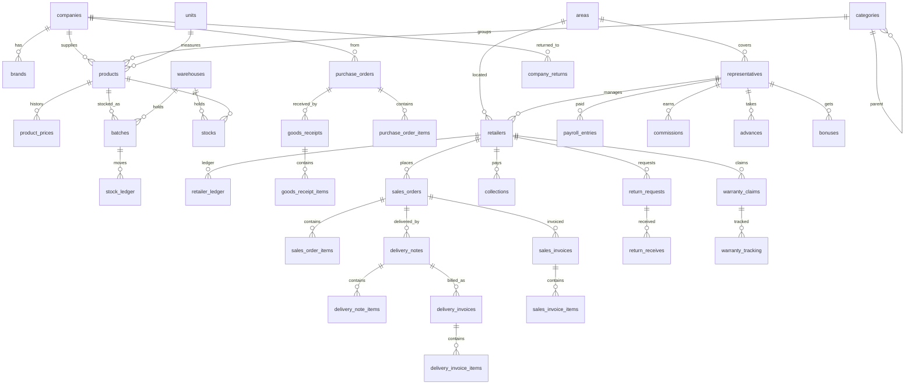

# DMS — ডাটাবেজ স্কেমা

উৎস: `database/migrations/`-এর সব migration। Laravel-এর `id()` মানে `BIGINT UNSIGNED` primary key। `timestamps()` মানে `created_at` আর `updated_at`। নিচের টেবিলগুলোতে এই দুটো আলাদা করে লেখা হয়নি।

টাকার কলাম `DECIMAL(14,2)`, পরিমাণের কলাম `DECIMAL(14,3)`, কমিশন রেট `DECIMAL(5,2)`।

FK-এর পাশের চিহ্ন: **null** = parent মুছলে NULL হয়, **cascade** = parent মুছলে row-ও মোছে, কিছু না লেখা থাকলে restrict।

> সর্বশেষ আপডেট: ২২ নভেম্বর ২০২৬ (সর্বশেষ migration: `2026_11_22_000005_create_hr_tables`)

---

## সূচি

1. [Core / Laravel](#১-core--laravel)
2. [Role ও Permission](#২-role-ও-permission)
3. [Settings](#৩-settings)
4. [Master Data](#৪-master-data)
5. [Inventory](#৫-inventory)
6. [People](#৬-people-representative-ও-retailer)
7. [Purchase](#৭-purchase)
8. [Sales](#৮-sales)
9. [Delivery ও Collection](#৯-delivery-ও-collection)
10. [Return ও Warranty](#১০-return-ও-warranty)
11. [Payroll](#১১-payroll)
12. [সম্পর্কের ডায়াগ্রাম](#১২-সম্পর্কের-ডায়াগ্রাম)

---

## ১. Core / Laravel

### users
| কলাম | টাইপ | নোট |
|---|---|---|
| id | bigint PK | |
| name | string | |
| email | string | unique |
| email_verified_at | timestamp | nullable |
| password | string | hashed |
| remember_token | string | nullable |
| notification_preferences | json | nullable (migration `2026_07_29`) |
| dealer_id | FK dealers | nullable, null = হেড অফিসের লগইন; সেট থাকলে ওই ডিলারের লগইন (migration `2026_11_22_000002`) |

### dealers (ডিলার)
| কলাম | টাইপ | নোট |
|---|---|---|
| code | string(20) | unique |
| name, owner_name | string | owner_name nullable |
| phone | string(30) | |
| email, address | string | nullable |
| area_id | FK areas | nullable, null |
| active | boolean | default true |

ডিলারের ক্রেডিট লিমিট আর বকেয়া থাকে তার হেড অফিস অ্যাকাউন্টে (`retailers.account_dealer_id`)।

### dealer_representative
হেড অফিসের প্রতিনিধি যে ডিলারদের কাছে বসানো: `dealer_id`, `representative_id` (দুটো মিলে primary key, দুটোই cascade)।

Laravel-এর ডিফল্ট টেবিলও আছে: `password_reset_tokens`, `sessions`, `cache`, `cache_locks`, `jobs`, `job_batches`, `failed_jobs`।

### notifications
| কলাম | টাইপ | নোট |
|---|---|---|
| id | uuid PK | |
| type | string | Notification class |
| notifiable_type, notifiable_id | morphs | সাধারণত User |
| data | json | `title`, `message`, লিংক |
| read_at | timestamp | nullable |

## ২. Role ও Permission

spatie/laravel-permission-এর টেবিল: `permissions`, `roles`, `model_has_permissions`, `model_has_roles`, `role_has_permissions`। রোল আর পারমিশনের তালিকা `plan.md`-তে আছে।

## ৩. Settings

### company_profiles
| কলাম | টাইপ | নোট |
|---|---|---|
| name | string | |
| address, phone, email | string | nullable |
| logo_path | string | nullable |
| invoice_footer | text | nullable |

### numbering_sequences
| কলাম | টাইপ | নোট |
|---|---|---|
| key | string | যেমন `sales_order` |
| year | smallint unsigned | |
| last_number | int unsigned | default 0 |

Unique: (`key`, `year`)

### audit_logs
| কলাম | টাইপ | নোট |
|---|---|---|
| user_id | FK users | null |
| action | string | |
| auditable_type, auditable_id | string, bigint | nullable, index |
| old_values, new_values | json | nullable |
| ip_address | string | nullable |

### login_histories
| কলাম | টাইপ | নোট |
|---|---|---|
| user_id | FK users | null |
| ip_address, user_agent | string | nullable |
| login_at, logout_at | timestamp | nullable |
| status | string | default `success` |

## ৪. Master Data

### companies
| কলাম | টাইপ | নোট |
|---|---|---|
| name | string | |
| code | string | unique |
| phone, email, address | string | nullable |
| active | boolean | default true |

### brands
| কলাম | টাইপ | নোট |
|---|---|---|
| company_id | FK companies | nullable, null |
| name | string | |
| code | string | unique |
| active | boolean | default true |

### categories
| কলাম | টাইপ | নোট |
|---|---|---|
| parent_id | FK categories | nullable, null (sub-category) |
| name | string | |
| code | string | unique |
| active | boolean | default true |

### units
| কলাম | টাইপ | নোট |
|---|---|---|
| name | string | |
| short_code | string | unique |
| kind | string(10) | `weight`, `volume`, `count`, `length`, default `count`। শুধু একই ধরনের ইউনিটের মধ্যে রূপান্তর হয় |

### unit_conversions (সাধারণ রূপান্তর)
| কলাম | টাইপ | নোট |
|---|---|---|
| from_unit_id, to_unit_id | FK units | cascade, জোড়াটা unique |
| factor | decimal(18,6) | ১ from = factor × to (যেমন ১ টন = ১০০০ কেজি)। দুই দিকেই ব্যবহার হয় (`App\Services\UnitConverter`) |

### products
| কলাম | টাইপ | নোট |
|---|---|---|
| company_id | FK companies | |
| brand_id | FK brands | nullable, null |
| category_id | FK categories | |
| unit_id | FK units | মূল ইউনিট; মজুদ সবসময় এই ইউনিটে |
| type | string(20) | `raw_material`, `packaging`, `semi_finished`, `finished_good`, `trading` (default)। বিক্রির অর্ডারে শুধু `finished_good`/`trading`, ক্রয়ের অর্ডারে শুধু `raw_material`/`packaging`/`trading` |
| sku | string | unique |
| barcode | string | nullable |
| name | string | |
| description | text | nullable |
| image_path | string | nullable |
| purchase_price, sale_price | decimal(14,2) | default 0 |
| reorder_level | decimal(14,3) | default 0 |
| shelf_life_days | unsigned int | nullable; কারখানায় তৈরি ব্যাচের সাধারণ মেয়াদ |
| active | boolean | default true |

### product_units (পণ্যের নিজস্ব প্যাক)
| কলাম | টাইপ | নোট |
|---|---|---|
| product_id | FK products | cascade |
| unit_id | FK units | (product_id, unit_id) unique; মূল ইউনিট হতে পারে না |
| factor | decimal(18,6) | ১ এই ইউনিট = factor × মূল ইউনিট (যেমন ১ বস্তা = ৫০ কেজি) |
| barcode | string | nullable |

### product_prices (দামের হিস্টোরি)
| কলাম | টাইপ | নোট |
|---|---|---|
| product_id | FK products | cascade |
| purchase_price, sale_price | decimal(14,2) | |
| effective_from | date | |
| created_by | FK users | null |

## ৫. Inventory

### factories (কারখানা)
| কলাম | টাইপ | নোট |
|---|---|---|
| code | string(20) | unique, বড় হাতের অক্ষরে |
| name | string | |
| address | string | nullable |
| phone | string(30) | nullable |
| manager_user_id | FK users | nullable, null |
| active | boolean | default true |

### warehouses
| কলাম | টাইপ | নোট |
|---|---|---|
| name | string | |
| type | enum | `central`, `branch` |
| factory_id | FK factories | nullable, null; কারখানার স্টোর হলে |
| dealer_id | FK dealers | nullable, null = হেড অফিসের গুদাম; সেট থাকলে ডিলারের গুদাম |
| purpose | string(20) | `general` (default), `raw_material`, `production`, `finished_goods`, `damage` |
| address | string | nullable |
| active | boolean | default true |

### areas
| কলাম | টাইপ | নোট |
|---|---|---|
| name | string | |
| code | string | unique |

### batches
| কলাম | টাইপ | নোট |
|---|---|---|
| product_id | FK products | |
| warehouse_id | FK warehouses | |
| batch_no | string | |
| expiry_date | date | nullable |
| cost_price | decimal(14,2) | |
| quantity_received | decimal(14,3) | |
| quantity_available | decimal(14,3) | FIFO-তে কমে |

### stocks
| কলাম | টাইপ | নোট |
|---|---|---|
| warehouse_id | FK warehouses | |
| product_id | FK products | |
| quantity | decimal(14,3) | default 0 |
| reorder_level | decimal(14,3) | default 0 |

Unique: (`warehouse_id`, `product_id`)

### stock_ledger
| কলাম | টাইপ | নোট |
|---|---|---|
| product_id | FK products | |
| warehouse_id | FK warehouses | |
| batch_id | FK batches | nullable, null |
| type | enum | `in`, `out`, `adjustment` |
| quantity | decimal(14,3) | |
| reference_type, reference_id | string, bigint | nullable, index (polymorphic) |
| balance_after | decimal(14,3) | |

### stock_adjustments
| কলাম | টাইপ | নোট |
|---|---|---|
| warehouse_id | FK warehouses | |
| product_id | FK products | |
| batch_id | FK batches | nullable, null |
| quantity_change | decimal(14,3) | ধনাত্মক বা ঋণাত্মক |
| reason | string | |
| adjusted_by | FK users | null |
| adjustment_date | date | |

## ৬. People (Representative ও Retailer)

### representatives
| কলাম | টাইপ | নোট |
|---|---|---|
| dealer_id | FK dealers | nullable, null = Agro Tech-এর কর্মচারী; সেট থাকলে ডিলারের নিজের লোক (নিয়োগকর্তা) |
| user_id | FK users | nullable, null (লগইন অ্যাকাউন্ট) |
| employee_code | string | unique |
| name | string | |
| phone | string | nullable |
| area_id | FK areas | nullable, null |
| salary_base | decimal(14,2) | default 0 |
| commission_rate | decimal(5,2) | % , default 0 |
| target_amount | decimal(14,2) | default 0 |
| active | boolean | default true |

### retailers
হেড অফিস বা কোনো ডিলারের গ্রাহক। ডিলারের হেড অফিস অ্যাকাউন্টও এখানে থাকে।

| কলাম | টাইপ | নোট |
|---|---|---|
| dealer_id | FK dealers | nullable, null = হেড অফিসের গ্রাহক; সেট থাকলে ওই ডিলারের গ্রাহক |
| account_dealer_id | FK dealers | nullable, unique; সেট থাকলে এই সারিটাই ওই ডিলারের হেড অফিস অ্যাকাউন্ট |
| user_id | FK users | nullable, null |
| representative_id | FK representatives | nullable, null |
| area_id | FK areas | |
| code | string | unique |
| name | string | |
| shop_name | string | nullable |
| phone | string | |
| address | string | nullable |
| credit_limit | decimal(14,2) | default 0 |
| current_due | decimal(14,2) | default 0 |
| active | boolean | default true |

### retailer_ledger
| কলাম | টাইপ | নোট |
|---|---|---|
| retailer_id | FK retailers | cascade |
| type | string | invoice / collection / return ইত্যাদি |
| reference_type, reference_id | string, bigint | nullable, index |
| debit, credit | decimal(14,2) | default 0 |
| balance_after | decimal(14,2) | |
| entry_date | date | |

## ৭. Purchase

### purchase_orders
| কলাম | টাইপ | নোট |
|---|---|---|
| number | string | unique (`PO-…`) |
| company_id | FK companies | |
| warehouse_id | FK warehouses | |
| status | enum | `draft`, `sent`, `partial`, `completed`, `cancelled` (default draft) |
| order_date | date | |
| expected_date | date | nullable |
| total_amount | decimal(14,2) | |
| created_by | FK users | null |

### purchase_order_items
| কলাম | টাইপ | নোট |
|---|---|---|
| purchase_order_id | FK | cascade |
| product_id | FK products | |
| quantity | decimal(14,3) | |
| unit_price | decimal(14,2) | |
| received_quantity | decimal(14,3) | default 0 |

### goods_receipts
| কলাম | টাইপ | নোট |
|---|---|---|
| number | string | unique (`GRN-…`) |
| purchase_order_id | FK | nullable, null |
| warehouse_id | FK warehouses | |
| receipt_date | date | |
| total_amount | decimal(14,2) | |
| created_by | FK users | null |

### goods_receipt_items
| কলাম | টাইপ | নোট |
|---|---|---|
| goods_receipt_id | FK | cascade |
| product_id | FK products | |
| batch_no | string | |
| expiry_date | date | nullable |
| quantity | decimal(14,3) | |
| unit_cost | decimal(14,2) | |

### purchase_returns
| কলাম | টাইপ | নোট |
|---|---|---|
| number | string | unique (`PRT-…`) |
| company_id | FK companies | |
| warehouse_id | FK warehouses | |
| return_date | date | |
| reason | string | nullable |
| status | enum | `draft`, `sent`, `completed` |
| total_amount | decimal(14,2) | |

### purchase_return_items
| কলাম | টাইপ | নোট |
|---|---|---|
| purchase_return_id | FK | cascade |
| product_id | FK products | |
| batch_id | FK batches | nullable, null |
| quantity | decimal(14,3) | |
| unit_cost | decimal(14,2) | |

## ৮. Sales

### sales_orders
| কলাম | টাইপ | নোট |
|---|---|---|
| number | string | unique (`SO-…`) |
| order_type | enum | `retailer`, `representative` |
| retailer_id | FK retailers | |
| representative_id | FK representatives | nullable, null |
| warehouse_id | FK warehouses | |
| status | enum | `pending`, `credit_hold`, `approved`, `partial`, `completed`, `cancelled` |
| order_date | date | |
| subtotal, discount, grand_total | decimal(14,2) | |
| approved_by | FK users | null |
| approved_at | timestamp | nullable |

`current_due + grand_total > credit_limit` হলে অর্ডারটি `credit_hold` অবস্থায় তৈরি হয়।

### sales_order_items
| কলাম | টাইপ | নোট |
|---|---|---|
| sales_order_id | FK | cascade |
| product_id | FK products | |
| quantity | decimal(14,3) | |
| unit_price | decimal(14,2) | |
| delivered_quantity | decimal(14,3) | default 0 |

### sales_invoices
| কলাম | টাইপ | নোট |
|---|---|---|
| number | string | unique (`INV-…`) |
| sales_order_id | FK | nullable, null |
| retailer_id | FK retailers | |
| invoice_date | date | |
| subtotal, discount, grand_total | decimal(14,2) | |
| paid_amount, due_amount | decimal(14,2) | |
| status | enum | `unpaid`, `partial`, `paid` |

### sales_invoice_items
| কলাম | টাইপ | নোট |
|---|---|---|
| sales_invoice_id | FK | cascade |
| product_id | FK products | |
| batch_id | FK batches | nullable, null |
| quantity | decimal(14,3) | |
| unit_price, line_total | decimal(14,2) | |

## ৯. Delivery ও Collection

### delivery_notes
| কলাম | টাইপ | নোট |
|---|---|---|
| number | string | unique (`DEL-…`) |
| sales_order_id | FK sales_orders | |
| delivery_type | enum | `dealer`, `representative` |
| delivered_by | FK users | null |
| delivery_date | date | |
| status | enum | `pending`, `in_transit`, `delivered`, `partial` |

### delivery_note_items
| কলাম | টাইপ | নোট |
|---|---|---|
| delivery_note_id | FK | cascade |
| sales_order_item_id | FK | |
| product_id | FK products | |
| batch_id | FK batches | nullable, null |
| quantity | decimal(14,3) | |

### delivery_invoices (migration `2026_08_14`)
| কলাম | টাইপ | নোট |
|---|---|---|
| number | string | unique (`DI-YYYY-NNNNNN`) |
| sales_order_id | FK | index |
| delivery_note_id | FK | index |
| retailer_id | FK retailers | |
| invoice_date | date | |
| subtotal, discount, grand_total | decimal(14,2) | |
| status | enum | `pending`, `finalized`, `printed` |

### delivery_invoice_items
| কলাম | টাইপ | নোট |
|---|---|---|
| delivery_invoice_id | FK | cascade, index |
| sales_order_item_id | FK | |
| product_id | FK products | index |
| batch_id | FK batches | nullable, null |
| quantity | decimal(14,3) | |
| unit_price, total_price | decimal(14,2) | |

### collections (Model: `PaymentCollection`)
| কলাম | টাইপ | নোট |
|---|---|---|
| number | string | unique (`COL-…`) |
| retailer_id | FK retailers | |
| collected_by | FK users | null |
| collection_date | date | |
| amount | decimal(14,2) | |
| method | string | default `cash` |
| reference_no | string | nullable |

## ১০. Return ও Warranty

### return_requests
| কলাম | টাইপ | নোট |
|---|---|---|
| number | string | unique (`RET-…`) |
| retailer_id | FK retailers | |
| requested_by | FK users | null |
| request_date | date | |
| status | enum | `pending`, `approved`, `rejected`, `received` |
| reason | string | nullable |

### return_request_items
| কলাম | টাইপ | নোট |
|---|---|---|
| return_request_id | FK | cascade |
| product_id | FK products | |
| quantity | decimal(14,3) | |
| unit_price | decimal(14,2) | nullable (migration `2026_07_28`) |
| reason | string | nullable |

### return_receives
| কলাম | টাইপ | নোট |
|---|---|---|
| number | string | unique (`RCV-…`) |
| return_request_id | FK | |
| received_by | FK users | null |
| warehouse_id | FK warehouses | |
| receive_date | date | |

### return_receive_items
| কলাম | টাইপ | নোট |
|---|---|---|
| return_receive_id | FK | cascade |
| product_id | FK products | |
| batch_id | FK batches | nullable, null |
| quantity | decimal(14,3) | |
| disposition | enum | `restock`, `damage`, `company_return` |

### company_returns
| কলাম | টাইপ | নোট |
|---|---|---|
| number | string | unique (`CRT-…`) |
| company_id | FK companies | |
| warehouse_id | FK warehouses | |
| return_date | date | |
| status | enum | `draft`, `sent`, `completed` |

### company_return_items
| কলাম | টাইপ | নোট |
|---|---|---|
| company_return_id | FK | cascade |
| product_id | FK products | |
| quantity | decimal(14,3) | |

### warranty_policies
| কলাম | টাইপ | নোট |
|---|---|---|
| product_id | FK products | nullable, null |
| category_id | FK categories | nullable, null |
| duration_months | int unsigned | |
| terms | text | nullable |

### warranty_claims
| কলাম | টাইপ | নোট |
|---|---|---|
| number | string | unique (`WAR-…`) |
| retailer_id | FK retailers | |
| product_id | FK products | |
| sales_invoice_id | FK | nullable, null |
| claim_date | date | |
| issue_description | text | nullable |
| status | enum | `pending`, `approved`, `rejected`, `replaced`, `repaired` |

### warranty_tracking
| কলাম | টাইপ | নোট |
|---|---|---|
| warranty_claim_id | FK | cascade |
| status | string | |
| note | text | nullable |
| changed_by | FK users | null |
| changed_at | timestamp | nullable |

## ১১. Payroll

### representative_targets
| কলাম | টাইপ | নোট |
|---|---|---|
| representative_id | FK | cascade |
| period | string | যেমন `2026-07` |
| target_amount, achieved_amount | decimal(14,2) | |

Unique: (`representative_id`, `period`)

### commissions
| কলাম | টাইপ | নোট |
|---|---|---|
| representative_id | FK | cascade |
| sales_invoice_id | FK | nullable, null |
| period | string | |
| delivered_amount | decimal(14,2) | |
| commission_rate | decimal(5,2) | |
| commission_amount | decimal(14,2) | |
| return_adjustment | decimal(14,2) | |

### advances
| কলাম | টাইপ | নোট |
|---|---|---|
| representative_id | FK | cascade |
| amount | decimal(14,2) | |
| advance_date | date | |
| reason | string | nullable |
| deducted | boolean | default false |

### bonuses
| কলাম | টাইপ | নোট |
|---|---|---|
| representative_id | FK | cascade |
| amount | decimal(14,2) | |
| reason | string | nullable |
| bonus_date | date | |

### payroll_entries
| কলাম | টাইপ | নোট |
|---|---|---|
| number | string | unique (`PAY-…`) |
| representative_id | FK | |
| period | string | |
| base_salary, commission_amount, bonus_amount | decimal(14,2) | |
| advance_deduction, other_deduction | decimal(14,2) | |
| net_salary | decimal(14,2) | |
| status | enum | `pending`, `paid` |
| paid_at | timestamp | nullable |

## ১২. সম্পর্কের ডায়াগ্রাম

## ১৩. Settings (অ্যাপ থেকে বদলানো যায়)

### app_settings (migration `2026_11_21`)
| কলাম | টাইপ | নোট |
|---|---|---|
| key | string | unique, যেমন `mail_host`, `sms_url`, `sms_event_delivered`, `sms_template_delivered` (বদলানো SMS-এর লেখা; না থাকলে ডিফল্ট), `fiscal_year_start_month` (১–১২, না থাকলে ৭ = জুলাই) |
| value | text | nullable; `mail_password` আর `sms_api_key` APP_KEY দিয়ে encrypted |

### sms_logs (migration `2026_11_21`)
| কলাম | টাইপ | নোট |
|---|---|---|
| to | string(30) | নম্বর (8801… বা 01…) |
| message | text | |
| event | string(50) | `order_approved`, `delivered`, `payment_received`, `test` |
| status | string(20) | `sent` বা `failed` |
| response | text | gateway-এর উত্তর (API key লুকানো) |

> `audit_logs` এখন ২৫টা মডেল থেকে নিজে থেকে ভরে (`App\Models\Concerns\Auditable`)। `stock_adjustments` টেবিল এখন Inventory → Stock Adjustments পেজ থেকে ব্যবহার হয়।

## ১৪. Accounts (দ্বি-তরফা হিসাব, migration `2026_11_22_000004`)

### accounts (হিসাবের তালিকা)
| কলাম | টাইপ | নোট |
|---|---|---|
| dealer_id | FK dealers | nullable; null = সবার জন্য একই তালিকা, সেট থাকলে শুধু সেই ডিলারের নিজের হিসাব (যেমন তার ব্যাংক) |
| code | string(20) | unique |
| name | string | |
| type | string(10) | `asset`, `liability`, `equity`, `income`, `expense` |
| parent_id | FK accounts | nullable; গ্রুপের অধীনে (একই type) |
| is_group | boolean | গ্রুপে সরাসরি এন্ট্রি হয় না |
| system_key | string(30) | nullable, unique; স্বয়ংক্রিয় এন্ট্রির হিসাব: `cash`, `bank`, `mobile`, `ar`, `ap`, `inventory`, `employee_advance`, `vat_input`, `vat_output`, `capital`, `retained_earnings`, `opening_equity`, `sales`, `sales_discount`, `sales_return`, `other_income`, `stock_gain`, `cogs`, `salary`, `commission`, `bonus`, `stock_loss` |
| is_cash, is_bank | boolean | টাকার হিসাব (পরিশোধ/প্রাপ্তি/ব্যাংক মিলানো) |
| bank_name, bank_branch, bank_account_no | string | nullable |
| description | text | nullable |
| active | boolean | |

ডিফল্ট তালিকা `ChartOfAccountsSeeder` থেকে, migration নিজেই চালায়।

### journal_entries (ভাউচার)
| কলাম | টাইপ | নোট |
|---|---|---|
| number | string | unique; JV/PV/RV/CV/OB/AJ/YC-বছর-ক্রমিক |
| dealer_id | FK dealers | nullable; কার খাতা (null = হেড অফিস) |
| type | string(20) | `journal`, `payment`, `receipt`, `contra`, `opening`, `auto`, `closing` |
| entry_date | date | |
| narration | text | nullable |
| status | string(10) | `draft` (হিসাবে ধরা হয় না) বা `posted` |
| source_type, source_id, source_event | | স্বয়ংক্রিয় এন্ট্রির উৎস; তিনটা মিলে unique (একই ঘটনা দুবার পোস্ট হয় না) |
| reversal_of_id | FK journal_entries | nullable; উল্টানো ভাউচার |
| created_by, approved_by, approved_at | | |

### journal_lines
| কলাম | টাইপ | নোট |
|---|---|---|
| journal_entry_id | FK | cascade |
| account_id | FK accounts | গ্রুপ নয় |
| debit, credit | decimal(16,2) | একটি লাইনে একটিই |
| party_type, party_id | | `retailer`, `company`, `head_office` (ডিলারের দেনা), `representative`; `ar`/`ap` লাইনে বাধ্যতামূলক |
| narration | string | nullable |
| cleared_at | date | nullable; ব্যাংক মিলানোয় টিক দেওয়া |

### fiscal_year_closings
`dealer_id`, `label` (যেমন 2025-26), `start_date`, `end_date`, `journal_entry_id` (সমাপনী ভাউচার), `closed_by`। বন্ধ বছরের তারিখে হাতে লেখা ভাউচার নেওয়া হয় না।

## ১৫. HR (migration `2026_11_22_000005`)

| টেবিল | মূল কলাম | নোট |
|---|---|---|
| departments | name, code | ডিফল্ট: প্রশাসন, হিসাব, উৎপাদন, বিক্রয় ও মার্কেটিং, স্টোর |
| designations | name, department_id | |
| shifts | name, start_time, end_time, grace_minutes, weekly_off | ডিফল্ট: সকাল ৯টা–সন্ধ্যা ৬টা, ১০ মিনিট ছাড়, শুক্রবার ছুটি |
| holidays | date (unique), name | সরকারি ছুটি |
| employees | dealer_id, employee_code (unique), name, father_name, phone, email, nid, address, date_of_birth, gender, join_date, exit_date, status (`active`/`resigned`/`terminated`), category (`office`/`factory`/`marketing`), department_id, designation_id, factory_id, shift_id, user_id, representative_id (unique; মার্কেটিং কর্মীর প্রতিনিধি প্রোফাইল), device_user_id (unique; ZKTeco), track_attendance, overtime_eligible, payment_method, bank_name, bank_account_no, basic, house_rent, medical, conveyance, other_allowance | migration হেড অফিসের প্রতিনিধিদের কর্মচারী বানায় |
| attendances | employee_id, date, in_time, out_time, status (`present`/`late`/`half_day`/`absent`/`leave`/`holiday`/`weekly_off`), overtime_minutes, source (`manual`/`csv`/`device`), note | (employee_id, date) unique |
| leave_types | name, code (unique), days_per_year, paid, active | ডিফল্ট: CL ১০, SL ১৪, EL ১৮, ML ১১২, LWP (বিনা বেতনে) |
| leave_applications | employee_id, leave_type_id, from_date, to_date, days, reason, status (`pending`/`approved`/`rejected`), decided_by, decided_at | |
| employee_loans | employee_id, type (`advance`/`loan`), amount, issue_date, installment, recovered, status (`open`/`closed`), paid_from, note | |
| payroll_runs | dealer_id, number (SAL-…), period (YYYY-MM), status (`draft`/`approved`/`paid`), approved_by/at, paid_at, paid_from | মাসে একটি |
| payslips | payroll_run_id, employee_id, month_days, payable_days, working_days, present_days, paid_leave_days, unpaid_leave_days, absent_days, basic … other_allowance, overtime_hours/amount, commission, bonus, gross, absent_deduction, advance_deduction, loan_deduction, other_deduction, net, note | |
| final_settlements | number (FS-…), employee_id (unique), exit_date, reason, salary_days/amount, leave_days, leave_encashment, service_years, gratuity, other_payable, loan_deduction, other_deduction, net, status (`draft`/`paid`), paid_from, paid_at, note | |

নতুন হিসাব: `5235 Gratuity & Leave Encashment` (`gratuity`), `5236 Overtime` (`overtime`)। ভাউচার লাইনের নতুন পক্ষ: `employee`।

---

## ১৬. Factory ও উৎপাদন (migration `2026_11_22_000006`)

| টেবিল | মূল কলাম | নোট |
|---|---|---|
| machines | factory_id, code (unique), name, kind (`line`/`machine`), capacity_per_hour, active | |
| boms | product_id, version, name, output_quantity (এক ব্যাচে), expected_yield %, notes, is_default, active, created_by | (product_id, version) unique; বদলালে নতুন ভার্সন |
| bom_items | bom_id, product_id (কাঁচামাল), quantity (প্রতি ব্যাচে), wastage_percent, sort | |
| production_orders | number (PRD-…), factory_id, product_id, bom_id, machine_id, planned_quantity, batch_no, mfg_date, expiry_date, raw/output/damage_warehouse_id, status (`planned`/`in_progress`/`qc`/`completed`/`cancelled`), started_at, finished_at, good_quantity, rejected_quantity, standard_cost, material_cost, labour_cost, overhead_cost, total_cost, unit_cost, output_batch_id, created_by, completed_by | এক সারি = এক উৎপাদন ব্যাচ |
| production_issues | production_order_id, issue_no, product_id, batch_id, quantity, unit_cost, issued_by | কোন কাঁচামালের কোন ব্যাচ কতটুকু গেল (ট্রেসের ভিত্তি) |
| production_qc_checks | production_order_id, result (`pass`/`fail`/`rework`), parameters, notes, checked_by, checked_at | |
| stock_transfers | number (TRF-…), from_warehouse_id, to_warehouse_id, transfer_date, notes, created_by | মালিক `from_warehouse_id` দিয়ে |
| stock_transfer_items | stock_transfer_id, product_id, batch_id (যেখান থেকে), to_batch_id (যেখানে), quantity | |

নতুন হিসাব: `1155 Work in Process` (`wip`), `5110 Production Labour & Overhead Applied` (`production_applied`)। ভাউচারের `source_event`: `issue_N` (কাঁচামাল ইস্যু), `completed`।
